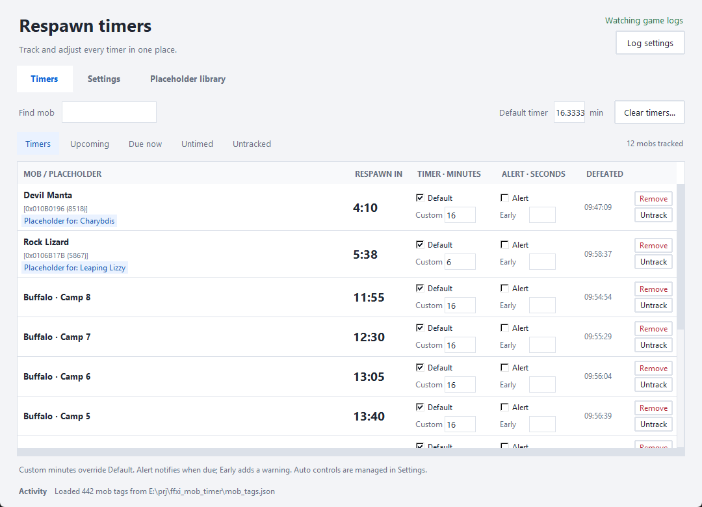
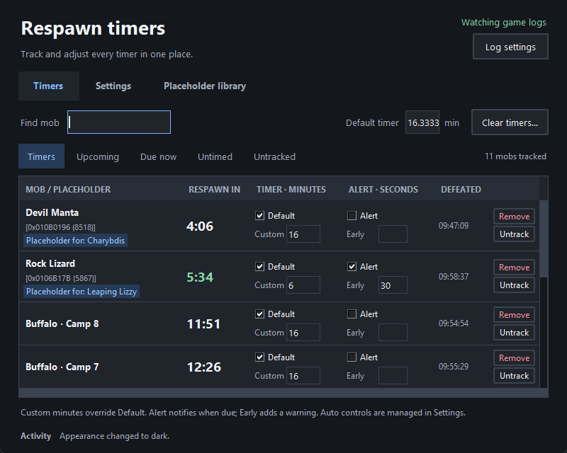

# FFXI Respawn Timer

Download the Windows x64 ZIP from [Releases](https://github.com/fitzpat/ffxi_respawn_timer/releases),
extract it, and run **FFXIRespawnTimer.exe**. Python is not required for the Windows build.
Choose your game's **chatlogs** folder in Settings to start watching defeats.





Run `run.bat` on Windows, or `python ffxi_mob_timer.py` with tkinter installed.
Enable **mobid addon** to track individual spawn slots and recognize NM placeholders.

The **Timers** view is a compact list with all timer controls directly in each
row. Use **Timers**, **Upcoming**, **Due now**, **Untimed**, or **Untracked** to narrow the list,
and **Find mob** to search names, IDs, or placeholder tags.

Each row shows the mob, countdown, duration, alerts, defeat time, and **Remove**.
Check **Default** to use the default timer or enter **Custom** minutes. Custom
minutes take priority; clear that field to return to the default. **Alert** enables
the due notification; **Early** adds a warning in seconds. Changes save immediately.
**Auto** labels identify controls managed by placeholder automation in Settings.

Choose **Untrack** below a row’s **Remove** button to move that mob ID to
**Untracked**. It keeps its settings but stops processing kills, recovery, sounds,
and alerts until you choose **Track** in the Untracked view. This choice persists
across restarts. **Timers**, **Upcoming**, **Due now**, and **Untimed** show tracked
mobs only. Clearing active timers preserves untracked IDs. **Remove** forgets a
mob entirely, so a future kill can create its timer again.

**Settings** contains log connection, placeholder automation, sounds, and appearance,
with shortcuts to each section. Choose **System**, **Light**, or **Dark** appearance.
**Placeholder library** lets you search by mob, NM, zone, or full ID and select an
entry to review its timing and source notes. It retains access to database editing
and reload.

Keyboard shortcuts: **Ctrl+F** finds mobs or library entries, **Ctrl+1/2/3** switches
views, and **Ctrl+,** opens Settings. **Escape** resets the active search and timer filter. Tab navigation scrolls form controls
into view.

Each mob row includes the hexadecimal ID and the last four decimal digits,
for example `Rock Lizard [0x0106617B (5867)]`. Placeholder tags appear underneath.
Matching always uses the full decimal ID, so identical suffixes do not collide.

At startup, the app scans approximately the last hour of chat logs for mobid
defeat messages whose full IDs are tagged as NM placeholders. It restores the
latest kill per ID using the original timestamp, including logs from before
midnight, while preserving newer saved timers and existing row settings. The
scan runs in the background and hands new kills to live watching. Historical
kills do not replay kill sounds or alerts whose trigger time has already passed;
future warnings and due notifications remain active. This recovery runs even
when the mobid checkbox is off, but it needs existing mobid addon messages in
the logs. Dates come from log filenames, or file modification time for undated logs.

The following options are independent and saved between sessions:

- **Warn 20 seconds before NM placeholders respawn** adds one warning 20 seconds before the tracked
  respawn is due, plus the due notification. For tagged placeholders it enables respawn alerts,
  fills Early warning with `20`, and greys out both controls. Turning it off restores the
  row's previous warning settings, including across restarts. Other rows keep
  their editable per-row warning settings.
- **Placeholder defeat sound** plays immediately when a tagged kill is detected.
  Its sound choice, WAV file, and Test button are separate from respawn notifications.
  Its default beep is one high note; the regular warning beep is three lower notes.
- **Use classic level-75 placeholder timers automatically** fills Custom minutes
  and deselects Use default timer for known timers, including existing and future rows. These
  controls remain disabled while managed automatically. Disabling the option restores
  the row's previous settings, including across an application restart. A placeholder
  with an unknown timer keeps its manual settings.

**Edit database…** in Placeholder library opens the database in a text editor (Notepad on Windows).
Saved changes reload within two seconds; **Reload** loads them immediately.
Invalid edits show an error and preserve the last successfully loaded tags.
The editable file lives beside the script or executable.

A minimal database entry looks like this:

```json
{
  "version": 1,
  "mobs": {
    "17215867": {
      "placeholder_for": ["Leaping Lizzy"],
      "respawn_seconds": 300,
      "despawn_seconds": 20,
      "tags": ["West camp"]
    }
  }
}
```

`respawn_seconds` is the placeholder's respawn delay after disappearance, not the
NM's lottery cooldown. The app times from the defeat message, so auto-override adds
`despawn_seconds` to that delay. The supplied database uses a 20-second corpse allowance,
so a 16-minute baseline becomes **16:20** from defeat (including Charybdis), and a
five-minute baseline becomes **5:20**. Both values remain editable. Set `despawn_seconds` to zero when your
`respawn_seconds` already measures the whole interval from defeat. Warnings predict
the next spawn opportunity, not a guaranteed NM appearance.

The supplied database contains 442 placeholder IDs for 269 NM names. It was built
from 248 LandSandBoat zone files at revision
`1450874235d41341a2ced74c1dbbe9e4477611d2`, with reviewed HorizonXI wiki corrections
and explicit Lua PH tables. Entries retain their sources and timing notes. The
inventory in `data/nm_scan_report.json` records 3,567 NM records and their resolved
placeholder IDs. NMs without mappings may be timed, forced, scripted, or unresolved.

The 150-name Horizon [lottery category](https://horizonffxi.wiki/Category:Lottery_Spawn_Notorious_Monsters)
was checked against the mappings. **Sozu Bliberry remains unresolved**: the
[wiki](https://horizonffxi.wiki/Sozu_Bliberry) identifies a Tonberry Imprecator near
I-6, but a verified full ID was not available in the scanned sources. LSB and Horizon
can differ; wiki pages also contain conflicting IDs or times. Main wiki NM-category
pagination was inaccessible, so this is not a claim of complete Horizon coverage.
`data/source_audit.json` records retrieval gaps. No live-game timing verification
was performed.

To regenerate a candidate database from an LSB checkout, install PyYAML for this
maintenance command and run:

```sh
python tools/build_mob_tags.py --lsb-root /path/to/lsb --ref CHECKOUT_COMMIT_SHA
```

This writes `mob_tags.generated.json`, preserving manual edits to `mob_tags.json`.
Reviewed adjustments live in `data/placeholder_supplements.json`. Recheck those
adjustments when changing the LSB revision. The timer itself needs no PyYAML.

Run tests with `python -m unittest -v`. Rebuild the Windows executable with
`build_exe.bat` using Windows Python and PyInstaller. The build bundles the database
and seeds an editable copy beside the executable without replacing existing edits.

For a real-window UI check, run `python tools/review_ui.py` with tkinter installed.
On Windows, add `--output ui-review/after` to capture the main views, empty states,
inline controls, and light/dark layouts. This uses temporary configuration and
sample timers; it does not change your saved timers or watch your game logs.
After rebuilding on Windows, `python tools/check_packaged_ui.py` checks the executable
in a temporary folder, including startup, bundled tags, saved timers, and clean exit.

If the app stops updating, keep `mob_timer_diagnostics.log` beside the executable.
It records callback errors and thread stacks when the window stops responding.
The log rotates locally and is excluded from Git and release packages. If the app
folder is not writable, the log is written to your system temporary folder.
Run `python tools/check_ui_liveness.py` with Windows Python to verify that open
dropdowns and recoverable callback errors do not stop timers or incoming kills.

Release builds run on Windows from version tags such as `v1.0.0`. The workflow runs
the regression suite, builds and checks the executable, then publishes the EXE,
portable ZIP, and SHA-256 checksums. Local settings, saved timers, build folders,
and review captures are excluded from Git and release packages.
